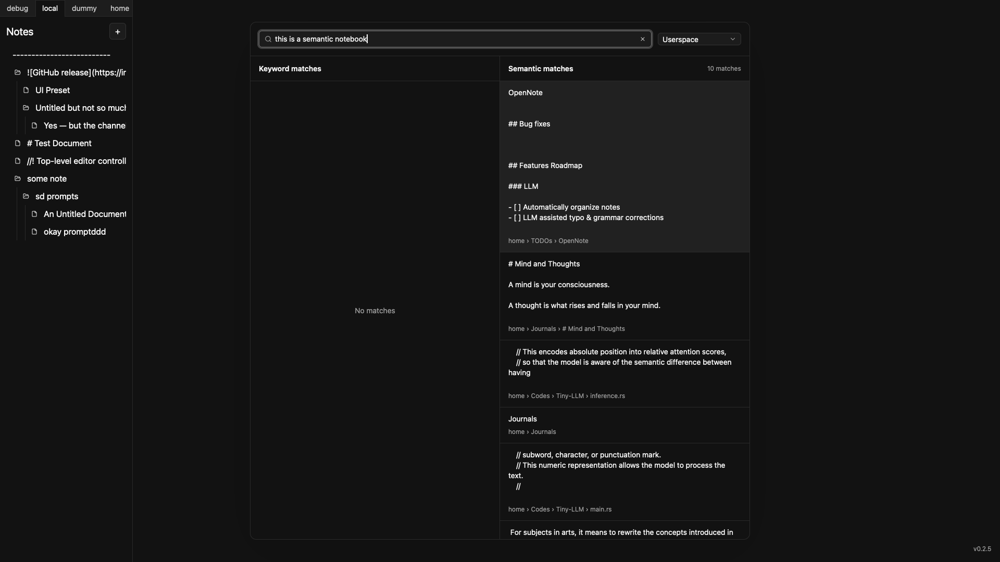

# OpenNote

A minimalistic notebook app built purely in Rust.

**Status: Heavy Development** — APIs, architecture, and workflows are evolving quickly. Contributions, feedback, and experimental use are all welcome.

<div align="center">
  
</div>

## Features

- **Keyword and semantic search** — find notes by exact terms or meaning.
- **Local-first** — store notes and run the default embedding model on your machine, without a hosted AI service.
- **Self-hosted server** — optionally run your own server to sync notes across devices with encrypted communications.
- **WYSIWYG Markdown editor** — edit and render Markdown in real time.
- **MCP integration** — connect an AI client to your notebooks, with configurable read/write permissions and access scopes.

## Roadmap

- [x] Self-hosted server for syncing documents across devices with encrypted communications
- [x] WYSIWYG markdown editor integration
- [ ] Advanced NLP features to simplify document management (e.g., automatic categorization by semantic similarity)
  - [x] Support both semantic and keyword search
- [x] MCP server support
  - [x] Control whether AI agents can read or write your notes
  - [x] Allow AI agents to operate your notebooks
  - [x] Restrict which notebooks AI agents can access
- [x] Import files
- [ ] Multi-modal support

## Getting Started

Download the release for your operating system from the [Releases page](https://github.com/opennote-org/opennote/releases), then follow the instructions below.

### macOS

1. Download and open `opennote-macos.dmg`.
2. Copy `opennote.app` to your `Applications` folder.
3. Open the app from `Applications`.

The macOS app is not code-signed. If macOS blocks it, and you trust the downloaded release, you may need to remove its quarantine attribute in Terminal:

```bash
sudo xattr -r -d com.apple.quarantine /Applications/opennote.app
```

### Windows

1. Download `opennote-windows-x86_64.zip`.
2. Extract the archive.
3. Double-click `opennote-desktop.exe` in the extracted folder.

### Linux

1. Download `opennote-linux-x86_64.tar.gz`.
2. Extract the archive.
3. Run `./linux-package/opennote-desktop` from the extraction directory.

### First Launch

On first launch, OpenNote downloads the default embedding model, `sentence-transformers/all-MiniLM-L6-v2`, from [Hugging Face](https://huggingface.co). If a network request fails, it tries [hf-mirror.com](https://hf-mirror.com). An internet connection is required for this initial download; cached model files are reused afterward.

For example workflows, see the [manuals](manuals), including [AI-Driven TODOs](manuals/AI_Driven_TODOs_with_OpenNote.md).

### Configure the Desktop App

Open the configuration editor with `Cmd + ;` on macOS or `Ctrl + ;` on Windows and Linux. You can also edit `configurations.json` directly at the following locations:

| Platform | Path |
| -------- | ---- |
| macOS | `~/Library/Application Support/opennote/configurations.json` |
| Linux | `~/.config/opennote/configurations.json` |
| Windows | `%APPDATA%\opennote\configurations.json` |

### Set Up a Remote Server

To host a server for syncing notes across devices, follow the [OpenNote Server README](crates/opennote-server/README.md), including its password and shared-key configuration instructions.

### Use the MCP Server

The MCP server is **enabled by default** and listens on `http://localhost:8080/`. Configure it under `user.mcp_server` in the configuration editor or in `configurations.json`.

Merge the following settings into your existing configuration; this is a partial example, not a replacement for the whole file. These values match the defaults:

```json
{
  "user": {
    "mcp_server": {
      "enabled": true,
      "host": "localhost",
      "port": 8080,
      "workers": 2,
      "scopes": [],
      "allow_read": true,
      "allow_write": false
    }
  }
}
```

| Setting | Purpose |
| ------- | ------- |
| `enabled` | Start the MCP server when the app launches. Set to `false` to disable it. |
| `host` / `port` | Bind address and port. Keep `host` set to `localhost` for local use. |
| `workers` | Number of Actix Web worker threads. |
| `scopes` | Allowed server names. An empty list allows all configured servers, including local notes. Use `["local"]` to allow only local notes, or list names from `user.remote_servers`. |
| `allow_read` | Allow AI clients to read and search notes. |
| `allow_write` | Allow AI clients to create, update, and delete notes. Enable only if you want editing workflows such as AI-managed TODOs. |

Point any MCP client that supports the Streamable HTTP transport at the server's URL. For example, add this to your client's MCP configuration:

```json
{
  "mcpServers": {
    "opennote": {
      "url": "http://localhost:8080/"
    }
  }
}
```

**Security:** The desktop MCP server binds to `localhost` by default and is intended for clients on the same machine. It does not require authentication, and its current configuration disables `Host`-header validation, so it does **not** provide DNS-rebinding protection. Do not expose it to the network or through a public proxy. Disable it when not needed, restrict `scopes`, and leave write access disabled unless required. Notes read by an AI client may be sent to that client's model provider; check the client's privacy settings before connecting.

### Reindex After Switching the Embedding Model

Switching embedding models requires rebuilding the vector indexes for your local notes and connected servers.

After you change the embedding model in the desktop configuration, restart the app to trigger reindexing. If reindexing fails, you can retry it using the Reindex action in the command bar.

Before reindexing connected servers, make sure their embedding configurations match the desktop configuration. Servers refuse reindexing when the relevant configurations do not match, to prevent incompatible indexes.

## Contributing

OpenNote is in active development and welcomes contributions of all kinds — bug reports, feature ideas, code, documentation, and design.

- Open issues and pull requests on [GitHub](https://github.com/opennote-org/opennote).
- Read the [development manual](docs/DEV_MANUAL.md) for the codebase layout, logging, and performance tips.
- Follow the [coding style guidelines](docs/CODING_STYLE.md).
- Explore the crate documentation in the source, or reach out with questions and ideas.

With Rust and the platform dependencies installed, run the desktop app from the repository root:

```bash
cargo run --release --package opennote-desktop
```

Use a release build when evaluating embedding performance; debug builds are significantly slower. See the [release workflow](.github/workflows/release.yml) for the toolchains and build dependencies used by CI.

## Credits

Kudos to all the libraries used in this project. See the full list in [Cargo.toml](./Cargo.toml) and in the `Cargo.toml` of each sub-crate.

Thanks to [appify](https://github.com/akx/appify) for bundling the executable as a macOS app.

Thanks to [SQLite](https://sqlite.org) for local relational storage.

Thanks to [sqlite-vector](https://github.com/sqliteai/sqlite-vector) for local vector storage.

Thanks to [velotype](https://github.com/manyougz/velotype) for the WYSIWYG Markdown editor.

Thanks to [gpui-kit](https://github.com/longbridge/gpui-kit) for UI components.

## License

MIT — see [LICENSE](./LICENSE).

This project includes code derived from [Zed](https://zed.dev) under the Apache 2.0 license — see [NOTICE.md](./NOTICE.md).
